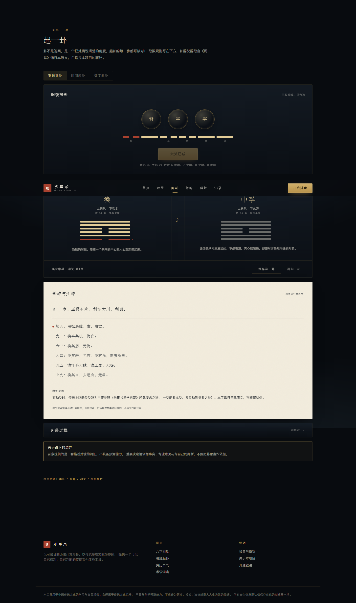

# 观星录

[](./LICENSE)
[](#测试)
[](https://nextjs.org)
[](./tsconfig.json)

中国传统命理文化的体验与研究工具。以可验证的历法算法完成八字排盘、易经起卦与黄历查询，用克制的东方美学呈现，并把「可计算的」与「可解释的」明确分开。


- 排盘算法来自经过许可证审查的 MIT 库，不自行编造历法
- 出生信息默认只保存在浏览器本地，没有账号、没有埋点
- AI 只做语言转译，且由服务端重新排盘，不接受客户端传来的四柱
- 每个可能因流派而异的判断都写明口径

**线上试用**：<https://guanxinglu.apps.workbuddy.host/?sharecode=ZU4EJAB6DJ>
（首次打开会写入一个 30 天的访问 Cookie，之后站内跳转不再需要 sharecode。）

| 命盘 | 问卦 |
| --- | --- |
|  |  |

---

## 快速开始

```bash
# 环境要求：Node.js ≥ 20（开发使用 22.22）
npm install
npm run dev          # http://localhost:3000
```

生产构建：

```bash
npm run build
npm start
```

启用 AI 解读（可选，不配也能用）：

```bash
cp .env.example .env.local
# 填入 AI_API_KEY，按需修改 AI_PROVIDER / AI_BASE_URL / AI_MODEL
```

---

## 脚本

| 命令 | 作用 |
| --- | --- |
| `npm run dev` | 开发服务器 |
| `npm run build` | 生产构建 |
| `npm start` | 启动生产服务 |
| `npm run typecheck` | `tsc --noEmit`，零容忍 |
| `npm test` | Vitest，103 项算法测试 |
| `npm run lint` | Next.js ESLint（需先配置 ESLint，见下） |

> `npm run lint` 依赖项目自行添加的 ESLint 配置；本项目未内置 ESLint 依赖，避免为 MVP 增加工具链。类型检查与测试已覆盖主要风险。

---

## 页面

| 路由 | 内容 | 渲染方式 |
| --- | --- | --- |
| `/` | 首页：主视觉、今日黄历、五个入口、最近记录、立场说明 | 服务端 |
| `/bazi` | 出生信息表单：公农历、时辰未知、出生地、子时流派 | 客户端 |
| `/bazi/result` | 命盘：四柱表、五行双口径、旺衰、刑冲合会、大运流年、计算依据 | 服务端 |
| `/bazi/reading` | 解读：8 个规则板块 + AI 语言转译 + 追问 | 服务端 + 客户端 |
| `/yijing` | 起卦：铜钱摇卦 / 时间起卦 / 数字起卦，本卦·动爻·变卦·卦辞爻辞 | 客户端 |
| `/almanac` | 黄历与节气：任意日期、年度二十四节气、文化卡片 | 服务端 |
| `/canon` | 术语词典：26 条、5 分类、搜索；流派与古籍介绍 | 服务端 + 客户端筛选 |
| `/history` | 本地记录：筛选、逐条删除、一键清空 | 客户端 |
| `/settings` | 设置、隐私、关于、开源致谢 | 客户端 |
| `/api/interpret` | AI 解读接口（唯一持有密钥的路由） | 服务端 API |

---

## 目录

```
docs/                     调研、技术设计、实施计划、部署与合规、使用指南
docs/images/              README 截图
src/app/                  路由
src/components/           布局、UI、视觉、各功能模块组件
src/lib/bazi/             排盘引擎、规则解读、静态表、类型
src/lib/yijing/           起卦算法、六十四卦数据
src/lib/almanac.ts        黄历与节气
src/lib/glossary.ts       术语词典
src/lib/storage.ts        localStorage 与 URL 编解码
src/lib/ai/provider.ts    模型调用封装（服务端）
tools/                    六十四卦数据生成脚本（yijing.json → hexagrams.ts）
```

---

## 测试

```bash
npm test
```

三个文件、103 项，覆盖：

- **四柱**：与独立实现 `Zijian-Ni/tianji` 的 7 条已知日期断言交叉校验；立春换年、惊蛰定月边界；晚子时两个流派；闰月；公农历互转
- **时间**：真太阳时偏移量级与对时柱的影响；1986–1991 夏令时窗口识别
- **派生信息**：五行计数自洽、缺失五行、日主一致、十神定义（甲日主逐一核对十神）
- **起卦**：三种起卦法的取数与动爻、变卦翻转、六十四卦数据完整性（64 卦唯一、爻象与上下卦一致、爻辞条数）
- **黄历**：节气日期（立春/冬至）、年度 24 节气、下一个节气跨年

测试只断言**可验证的计算**。解读文字属传统理论，不做「正确性」断言。

---

## 算法与数据来源

| 用途 | 来源 | 许可证 |
| --- | --- | --- |
| 公农历、节气、四柱、十神、大运、黄历 | [`lunar-typescript`](https://github.com/6tail/lunar-typescript) 1.8.6 | MIT |
| 真太阳时 | [`true-solar-time`](https://www.npmjs.com/package/true-solar-time) 1.2.1 | MIT |
| 交叉校验基准 | [`Zijian-Ni/tianji`](https://github.com/Zijian-Ni/tianji)（未引入代码） | MIT |
| 卦辞爻辞 | 《周易》通行本（公有领域） | — |

完整清单与商用结论见 [`THIRD_PARTY_LICENSES.md`](./THIRD_PARTY_LICENSES.md)，
选型过程与被排除的项目见 [`docs/OPEN_SOURCE_RESEARCH.md`](./docs/OPEN_SOURCE_RESEARCH.md)。

---

## 文档

- [使用指南](./docs/USER_GUIDE.md) — 第一次打开该怎么点：五分钟路径、每个页面看什么、手机上怎么用、怎么发给别人
- [开源项目调研](./docs/OPEN_SOURCE_RESEARCH.md) — 候选仓库逐一评估、许可证判定、交叉校验记录
- [技术设计](./docs/TECHNICAL_DESIGN.md) — 架构、数据流、设计系统、关键决策、已知限制
- [实施计划](./docs/IMPLEMENTATION_PLAN.md) — 各阶段进度、验证记录、后续路线、风险登记
- [部署与合规](./docs/DEPLOYMENT.md) — 部署架构、AI 成本模型、个人信息处理、商用许可检查

---

## 已知限制

1. 未实现紫微斗数、六爻纳甲（界面没有假装做了）
2. 真太阳时未处理 1949 年前的地方时与战时夏令时
3. 城市经纬度为精简表（约 30 个主要城市），不含县级市；可在表单中直接填经度
4. AI 输出只做提示词约束，没有结构化校验（改进方向见实施计划 P0）
5. 内存限流仅适用于单实例部署
6. 仅简体中文

---

## 立场

命理属于传统文化范畴，不具备科学预测能力，不应作为医疗、投资、法律或重大人生决策的依据。
本项目把历法计算（可复算）与传统解释（有流派分歧）分开呈现，目的是提供一套可以自己核对的观察词汇，而不是给出人生答案。

---

## 贡献

Issue 和 PR 都欢迎，尤其这几类：

- **算法口径**：某个日期/时区的排盘与你的师承或万年历不一致（请附日期、时间、地点、期望结果）
- **节气与历法边界**：立春、子时、闰月附近的用例
- **文案准确性**：术语释义、卦辞校对（《周易》原文请以通行本为准）
- **可访问性与移动端**：键盘操作、对比度、小屏排版

改动前请先跑 `npm run typecheck && npm test`。核心计算逻辑的 PR 请同时补测试，只改文档的 PR 不需要。

**不接受**的改动：把解读文案改成恐吓式/绝对化断言、加入付费墙或诱导分享、引入无许可证或 GPL/AGPL 代码（会破坏本项目的商用许可）。

---

## 许可证

本项目代码以 [MIT](./LICENSE) 发布，可自由使用、修改、分发，包括商用。

但请注意：

- **依赖与素材**的许可证单独适用，见 [`THIRD_PARTY_LICENSES.md`](./THIRD_PARTY_LICENSES.md)（其中 `sharp` 含 LGPL 组件，分发产物时需履行相应义务）。
- **《周易》卦辞爻辞**属公有领域；白话解读、术语释义为本项目原创，同样以 MIT 发布。
- **命理内容不构成任何建议**。MIT 许可证只涉及代码，不构成对内容准确性的担保。
